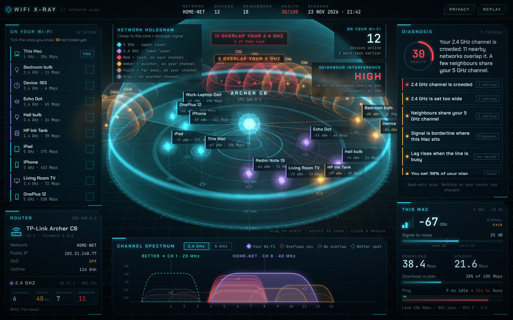

# wifi-xray

A Claude skill that scans the Wi-Fi network your computer is on and turns it into an interactive 3D "X-ray": your router in the middle, every device around it, your neighbours' networks as domes, and a plain-language diagnosis.

It answers two questions first:

1. **Who is on my Wi-Fi?** Every device, plus the ones your router remembers. Tick the ones you know.
2. **Are my neighbours' routers interfering?** Which networks sit on your channel, how loud each one is, and a low, medium or high rating.



## What the page has

- A 3D hologram of the network: devices on a 5 GHz layer and a 2.4 GHz layer, neighbours as red, amber, faint or grey domes
- The device list with name, band and link speed, and a tick box for "I know this one"
- A channel spectrum for 2.4 GHz and 5 GHz, with the clearer channel marked when there is one
- Measured download and upload speed, and ping when the line is idle and when it is busy
- Your router's channel and width on each band, as seen from the air
- A health score and findings, each with what to do about it
- A privacy mode (press P) that hides names and addresses for screenshots

Everything is in one HTML file.

## What it does not do

- **It does not change anything.** The scan is read-only. It never touches a router setting, the Wi-Fi name, a password or the firmware. The page tells you what to change; you make the change yourself.
- **It does not promise speed.** Most slow Wi-Fi comes from distance, walls, an old router or the provider, and no software fixes those.
- **It cannot tell you who owns a device.** It shows the list; you recognise your own.

## Install

You need [Claude Code](https://claude.com/claude-code) (the terminal app, or the Code tab of the desktop app), Python 3.9 or newer, and a computer connected to the Wi-Fi you want to check.

```bash
git clone https://github.com/ashmitmittal/wifi-xray-skill.git
mkdir -p ~/.claude/skills
cp -r wifi-xray-skill/wifi-xray ~/.claude/skills/
```

The skill has to run on your own computer. In a regular chat, or in a sandboxed session, the commands run on a machine somewhere else that cannot see your home network.

On a Mac the skill uses Apple's own Python at `/usr/bin/python3`, which comes with the Xcode Command Line Tools. Python from Homebrew or python.org also runs it, but macOS hides the other devices on your network from those unless you allow "Python" under System Settings → Privacy & Security → Local Network. The first scan may also ask whether your terminal app may find devices on your local network; allow it.

## Use

Start Claude Code and ask in plain words:

```
Who is on my Wi-Fi?
```

```
Is my neighbour's router slowing my Wi-Fi down? Scan my network.
```

Claude runs the scan (about a minute), opens the page and gives you the result in a few lines.

It then offers one optional step to put real names on the devices. You open your router's page, log in, open the list of connected devices, press Select All and Copy, and type "done". Claude reads what you copied and rebuilds the page with names. No browser extension is needed, and Claude never sees your router password.

To see the page without scanning anything:

```bash
python3 ~/.claude/skills/wifi-xray/scripts/wifixray.py demo --open
```

## With and without the router's device list

| | Scan only | After you copy the router's device list |
| --- | --- | --- |
| Your link, speed and lag | Yes | Yes |
| Neighbours and channel overlap | Yes | Yes |
| Devices | Addresses only; sleeping phones are often missed | Names, link speed, and devices connected earlier |
| Router | Brand only | Model and public IP, when the page shows them |

You type the router password into your own browser. The skill never asks for it.

## How it works

- **The engine** (`wifi-xray/scripts/wifixray.py` and `wifi-xray/assets/template.html`) reads the Wi-Fi link and nearby networks from the operating system, runs a speed test, pings each address of the home network once, works out which neighbours overlap your channel, and builds the page. It is plain Python with nothing to install.
- **Claude** runs the steps, reads the device list you copy from your router, and tells you the result in a few plain lines, including what the scan could not see.

`wifi-xray/references/data-format.md` documents the files and the exact thresholds behind every rating.

## Privacy

The scan runs on your computer and the report stays in a folder on your disk. It contacts the internet for three things only:

- the speed test (Apple's `networkQuality` on macOS; otherwise a download and upload against `speed.cloudflare.com`);
- a one-time download of Wireshark's public list of hardware makers, cached in `~/.cache/wifi-xray/`;
- fonts and the three.js library when you open the page.

No device names, addresses or scan results are sent anywhere. The report folder does contain them, so do not post it or commit it; use the page's privacy mode for screenshots.

## Limits

- **macOS hides Wi-Fi network names** from command-line tools, so neighbours are identified by channel and strength, and your router's other band is picked out by signal strength. If you have a mesh system or an extender, its other units can be counted as neighbours.
- **The interference rating counts overlapping networks and how loud they are.** It cannot see how busy they are.
- **Device search without the router login is incomplete.** Phones that are asleep often do not answer.
- **Many routers do not report signal strength per device.** The page then places devices by link speed.
- **Reading the copied device list depends on the router's page.** Tested on a TP-Link Archer C6 only. Many pages show a device's band as an icon that does not copy, so the band can be missing.
- **The health score is this skill's own number**, not a standard.

## Status

Built and tested on macOS with Claude Code, on one home network with a TP-Link Archer C6. The Windows scanner is written from the documented `netsh` output and has not been run on a real PC yet. Linux is not supported yet.

Only scan networks you own or run.

## Credits

- 3D rendering: [three.js](https://threejs.org/)
- Hardware maker lookup: the `manuf` file published by the [Wireshark](https://www.wireshark.org/) project
- Fonts: Chakra Petch and JetBrains Mono, from Google Fonts

## Licence

MIT. See [LICENSE](LICENSE).
